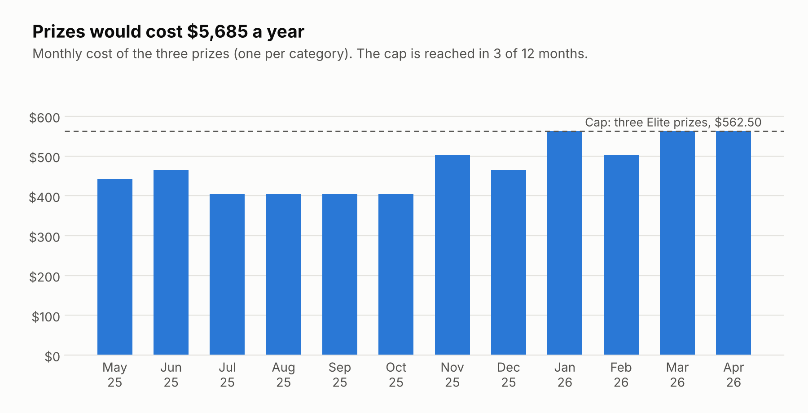
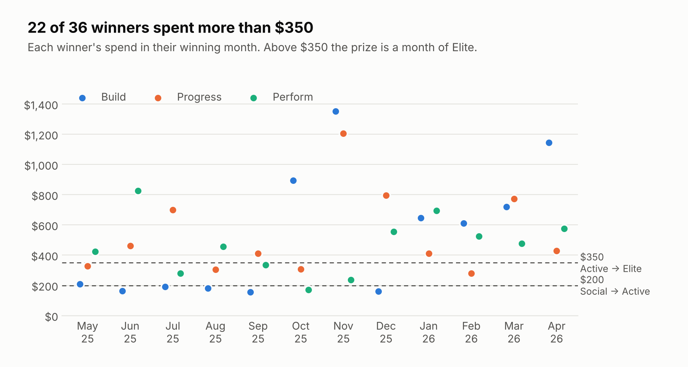
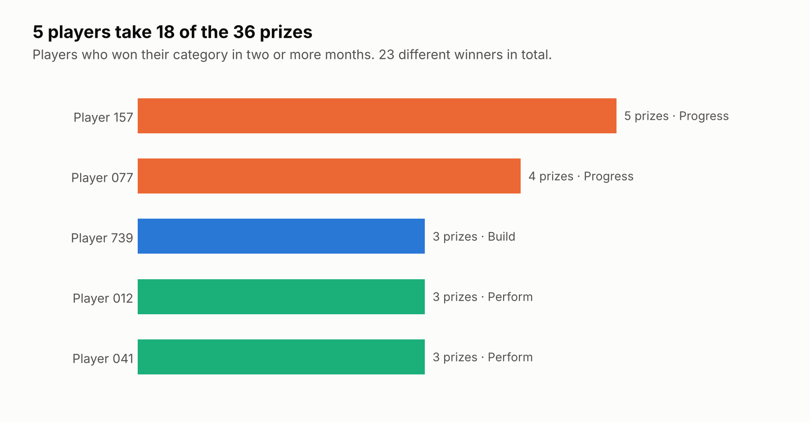

# Arenna Points

Simulating a points-based loyalty program for a padel club on 12 months of real, anonymized payment data.

**The problem.** Arenna Denver Padel wants to reward players who keep coming back: every open play, clinic or private lesson earns points, and the top player each month wins a month of membership, bigger the more they spent. Before launching, the club needs to know what it would cost and whether prizes would reach many players or always the same few.

**The answer.** On a year of data from another padel club that runs on the same booking system (Playbypoint), prizes would cost **$5,685 a year (about $474 a month)**, 31% of what those winners spent in their winning month. But **5 players would take half of the 36 prizes**. One simple rule, no back-to-back wins, raises the number of different winners from 23 to 28 at the same cost.

## Results



The cost is stable and never exceeds the $562.50 cap (three Elite prizes), because there is a single winner per category.



The players who play most also spend most: 22 of 36 winners spent more than $350 and won Elite. The other 14 won Social or Active, 13 of them in 2025, while the club was still new. From January 2026 almost every prize is Elite, so the spend tiers stop making a difference.



A loyalty program that keeps rewarding the same five players builds no new loyalty: those players were already coming.

### Comparing rules

| Rule | Prizes | Different winners | Annual cost |
| --- | --- | --- | --- |
| Top player in each category wins | 36 | 23 | $5,685 |
| Top player who did not win last month wins | 36 | 28 | $5,625 |

**Recommendation to the club:** launch with the no-back-to-back-wins rule, and recalibrate the spend tiers to Arenna's prices, which are higher than this club's.

## Point rules

| Activity | Points |
| --- | --- |
| Open play | 10 |
| Clinic | 10 |
| Private lesson | 20 |
| 4 consecutive weeks with activity | +20 |
| Off-peak activity | +5 (off in this simulation) |
| No-show | −5 (no data in this simulation) |

All rules live in [`src/rules.py`](src/rules.py): changing a rule means changing one number in one file.

## Data and cleaning decisions

The payments report has 15,577 rows from May 2025 to May 2026. The exploration in [`notebooks/01_exploration.ipynb`](notebooks/01_exploration.ipynb) led to these decisions:

| Decision | Why | Rows |
| --- | --- | --- |
| Keep only open plays, clinics and lessons | The activities that earn points | 4,517 |
| Drop refunded payments | Every "Reversal of..." row points (`reversed_id`) to a payment with status `Totally refunded` or `Refunded to credit`, so dropping those two statuses handles every reversal | −237 (with Guest Player) |
| **Keep** payments with no status | Not errors: they are club-credit payments, which never go through a card charge. Dropping them removed 11% of open plays, exactly those of customers loyal enough to buy credits | kept |
| Drop Junior programs | The prize is an adult membership | −72 |
| Play date from the program name | Open plays carry no session date: it is written in the description ("... - May 8 2025"). When missing, the payment date is used (median gap between payment and play: 1 day) | 182 use payment date |
| Identify players by name | The report has no phone or email, and `member_id` only exists for members (180 of 1,037 names) | |
| **Result** | | **4,208 activities** |

Each player competes in the category they played most, by program level: Build (below 2.0), Progress (2.0 to 2.9) and Perform (3.0 and up). That gives 283, 173 and 129 players; 21 who only took private lessons have no level and do not compete.

Monthly spend includes everything consumed at the club (courts, open plays, clinics, lessons, events, shop), excluding memberships and credit top-ups so nothing is counted twice.

## How it is built

```
data/club_payments.csv ──▶ src/club_source.py ──▶ standard activities ──▶ src/engine.py ──▶ ranking and prizes
      (private)               (club adapter)            table              (club-agnostic)
```

The engine does not know where the data comes from. Running it for Arenna only needs another adapter that turns Arenna's export into the same standard table.

| File | What it does |
| --- | --- |
| `src/rules.py` | Points, categories, prizes and off-peak hours |
| `src/club_source.py` | Cleans the payments report and anonymizes players |
| `src/engine.py` | Computes points, streaks, categories and the monthly ranking |
| `simulate.py` | Runs the 12 months and writes the results and figures |
| `notebooks/01_exploration.ipynb` | The data exploration behind the cleaning decisions |

## Limitations

- It is a **payments** report, not attendance: a paid activity is assumed to have been played, and there are no no-shows.
- Open plays and clinics have no **start time**, so the off-peak bonus could not be simulated.
- Identifying players by **name** can merge two people with the same name or split one person spelled two ways. Arenna's version uses the phone number.
- This club's prices are lower than Arenna's, so the spend tiers ($200 and $350) need recalibrating.

## Running it

```bash
python3 -m venv .venv
source .venv/bin/activate
pip install -r requirements.txt
python simulate.py
```

It needs the payments report at `data/club_payments.csv`. The `data/` folder is never committed: it holds the raw data and the table linking each real name to its anonymous code.
